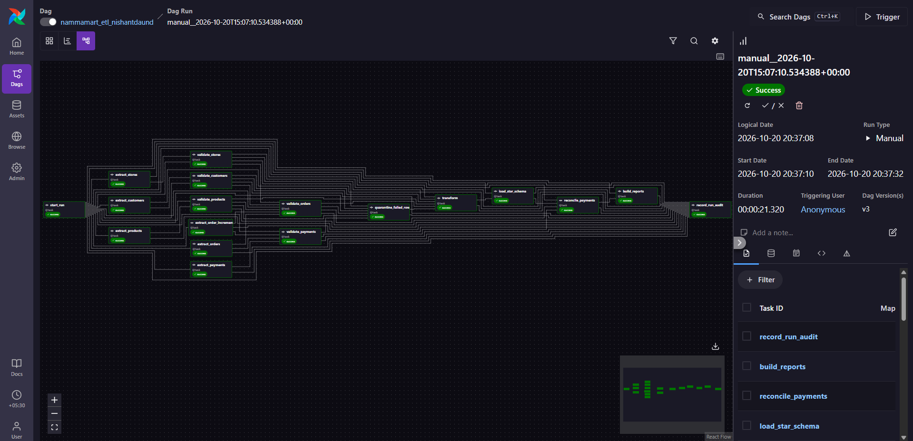
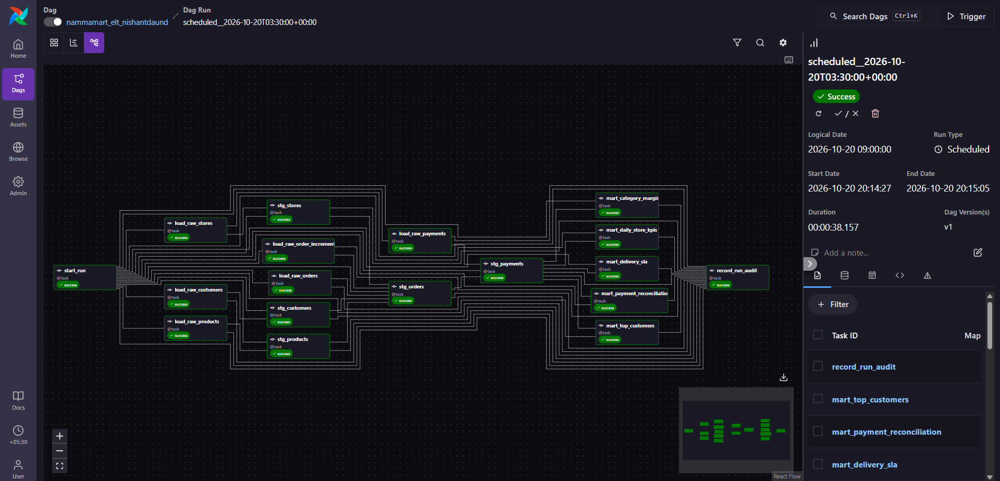
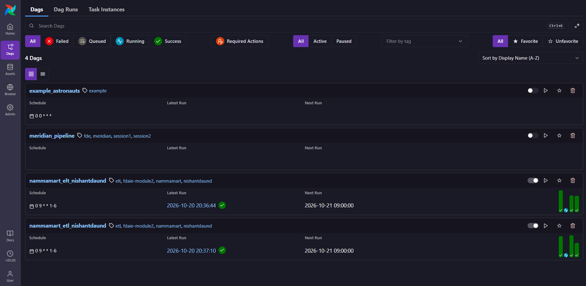
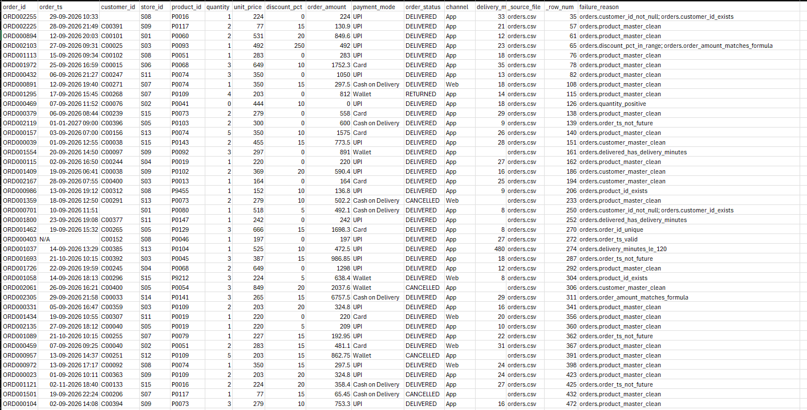
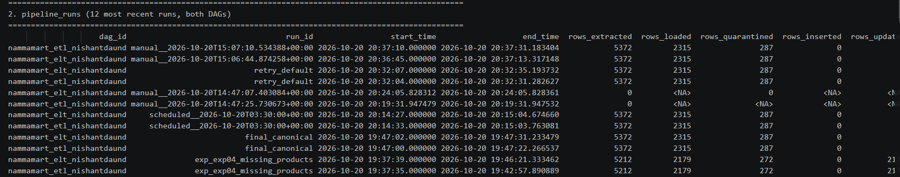
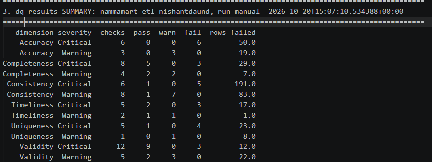
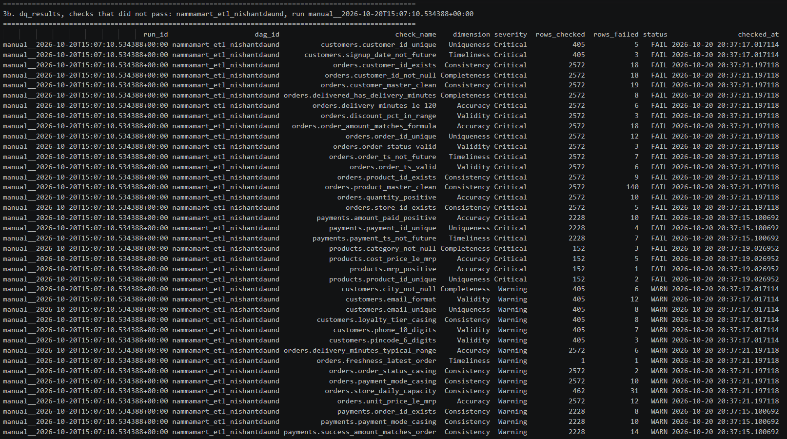
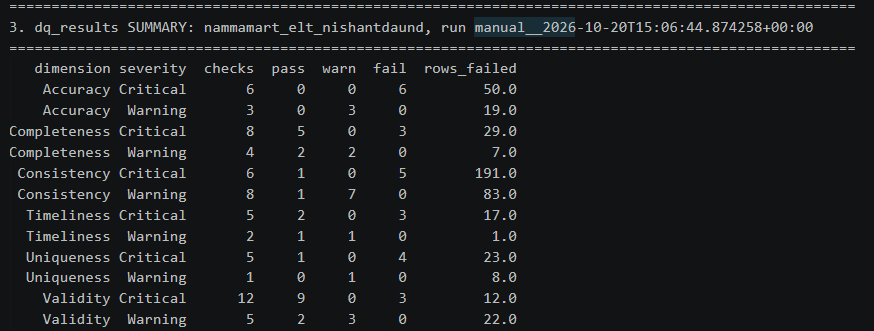
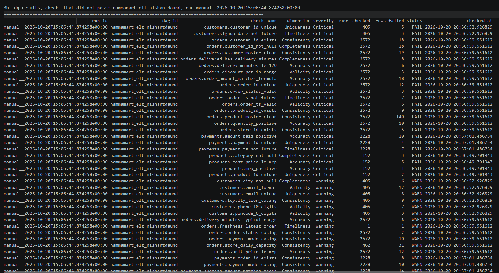
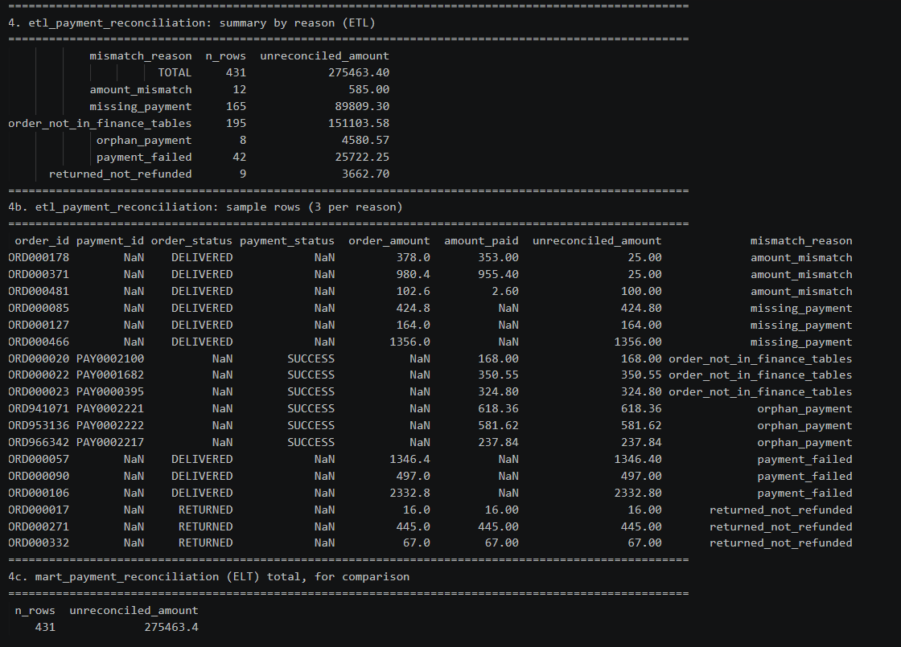

# NammaMart ETL & ELT Pipelines: Submission

Learner: **nishantdaund** · DAGs: `dags/nammamart_etl_nishantdaund.py`, `dags/nammamart_elt_nishantdaund.py`
Warehouse: `include/warehouse_nishantdaund.duckdb` · Quarantine: `include/quarantine/nishantdaund/`
Code: `include/nammamart/` (rules, masking, reconcile, ETL/ELT steps), SQL in `include/sql/`, tests in `tests/nammamart/` (73 passing).

**How it was verified:** both DAGs ran in Airflow 3.3 (Astro) on this machine, with the happy path, re-run, increment, and experiments 4–10 recorded below. Locally, `scripts/run_local.py` ran the same code without Airflow and the ETL-vs-ELT parity table matched on every metric.

**Not included, to be added by the submitter:** the screenshots listed in the checklist (they need a person at the Airflow UI) and the GitHub link.

---

## 0. Data profiling: Data Issues Log

Issues were found in **all five files** plus the increment. Severity follows the Part D rules (Critical = quarantined, Warning = loads and is logged). Full machine-readable catalogue: table `dq_check_catalog` (65 checks: 42 Critical, 23 Warning).

| File | Row key(s) | Column | Problem | Dimension | Rule | Severity |
|---|---|---|---|---|---|---|
| orders | 12 rows, e.g. repeated order_ids | order_id | exact duplicate rows | Uniqueness | `orders.order_id_unique` (first wins) | Critical |
| orders | 18 rows | customer_id | null | Completeness | `orders.customer_id_not_null` | Critical |
| orders | 8 DELIVERED rows | delivery_minutes | missing for a delivered order | Completeness | `orders.delivered_has_delivery_minutes` | Critical |
| orders | ORD000403, ORD000362, ORD001610, ORD000534, ORD002012, ORD000946 | order_ts | `N/A`, blank, `2026-13-05`, `31/09/2026` | Validity | `orders.order_ts_valid` (strict format) | Critical |
| orders | ORD000500, ORD001970, ORD001637 | order_status | `Pending??` | Validity | `orders.order_status_valid` | Critical |
| orders | ORD001066, ORD000153 | order_status | `delivered` (casing) | Consistency | standardised to upper case, logged | Warning |
| orders | 10 rows | payment_mode | `upi`, `UPI `, `Cashh`, `cod`, `CARD` | Consistency | alias map to canonical, logged | Warning |
| orders | ORD002103, ORD001468, ORD001237 | discount_pct | 250, 120, 150 (> 100) | Validity | `orders.discount_pct_in_range` | Critical |
| orders | ORD001296, ORD001459, ORD000867, ORD000462, ORD001384, ORD001124 (cancelled) | quantity | negative | Accuracy | `orders.quantity_positive` | Critical |
| orders | ORD000469, ORD002360, ORD001724, ORD000099 | quantity | zero | Accuracy | `orders.quantity_positive` | Critical |
| orders | 18 rows | order_amount | does not equal qty × price × (1 − disc) | Accuracy | `orders.order_amount_matches_formula` | Critical |
| orders | ORD001037, ORD002101, ORD000455 (1,440 min), ORD001104, ORD000020, ORD000424 | delivery_minutes | 480 to 1,440 minutes | Accuracy | `orders.delivery_minutes_le_120` | Critical |
| orders | 9 rows (P9212 …) | product_id | not in products.csv | Consistency | `orders.product_id_exists` | Critical |
| orders | 5 rows (S00, S17, S99) | store_id | not in stores.csv | Consistency | `orders.store_id_exists` | Critical |
| orders | ORD002119, ORD001725, ORD001765 (2027), ORD001121, ORD001965 (2026-11-02), ORD001693, ORD001089 (2026-10-21) | order_ts | after the file's export cut-off | Timeliness | `orders.order_ts_not_future` | Critical |
| payments | PAY0000509, PAY0000755, PAY0001651, PAY0002000 | payment_id | duplicated | Uniqueness | `payments.payment_id_unique` | Critical |
| payments | 10 rows (e.g. PAY0001568, PAY0000116) | amount_paid | zero or negative | Accuracy | `payments.amount_paid_positive` | Critical |
| payments | PAY0002217 to PAY0002224 | order_id | no such order (`ORD97…`) | Consistency | `payments.order_id_exists` | Warning (shown in reconciliation) |
| payments | 14 rows | amount_paid | SUCCESS amount ≠ order_amount | Consistency | `payments.success_amount_matches_order` | Warning (shown in reconciliation) |
| payments | 7 rows | payment_ts | after the cut-off (mirrors the future orders) | Timeliness | `payments.payment_ts_not_future` | Critical |
| payments | 301 rows | gateway_ref | blank, all Cash on Delivery | Completeness | only non-cash must carry one, so 0 failures | Warning |
| customers | C00036, C00103, C00226 (+2 more) | customer_id | 5 duplicate rows with conflicting phone/area | Uniqueness | `customers.customer_id_unique` (first wins) | Critical |
| customers | 8 rows | email | email already used by another row | Uniqueness | `customers.email_unique` | Warning |
| customers | 12 rows | email | `N/A`, missing `@`, no TLD | Validity | `customers.email_format` | Warning |
| customers | 7 rows | phone | 7 to 9 digits | Validity | `customers.phone_10_digits` | Warning |
| customers | C00132, C00083, C00166 | pincode | `5600XX` | Validity | `customers.pincode_6_digits` | Warning |
| customers | C00400, C00398, C00038 | signup_date | 2026-11 to 2027-01 | Timeliness | `customers.signup_date_not_future` | Critical |
| customers | 8 rows | loyalty_tier | `BRONZE`, `bronze`, `SILVER` | Consistency | `customers.loyalty_tier_casing` | Warning |
| customers | 6 rows | city | blank | Completeness | `customers.city_not_null` | Warning |
| products | P0030, P0140 | product_id | duplicated as an "(old)" row with a different mrp | Uniqueness | `products.product_id_unique` (old loses) | Critical |
| products | P0051, P0060, P0068 | category | blank | Completeness | `products.category_not_null` | Critical |
| products | P0109 | mrp | −203 | Accuracy | `products.mrp_positive` | Critical |
| products | P0019, P0073, P0074, P0109, P0117 | cost_price | above mrp | Accuracy | `products.cost_price_le_mrp` | Critical |
| stores | S07 | zone | blank | Completeness | `stores.zone_not_null`; loads as `Unassigned` | Warning |
| stores | S12 | capacity_orders_per_day | 0 | Accuracy | `stores.capacity_positive` | Warning |
| increment | ORD000017 and 9 others | order_status | 10 existing orders now RETURNED (legitimate corrections) | n/a | applied by MERGE | n/a |

### Questions I would ask the client before building
1. **A negative quantity: return or data-entry error?** I treat it as an error and quarantine it. If it is a return, it should arrive as a RETURNED row, not a negative sale.
2. **If a product row is bad (cost_price > mrp, blank category), should every order on it be held back?** I do hold them back, which removes 115 September orders (about 5%) from revenue until the catalogue is fixed. Finance may prefer to load them and flag the margin.
3. **Store S07 has no zone, and its payments and orders are real. Which zone is it?** Until answered it reports as `Unassigned` (₹74,011 of September revenue).

---

## A / B. What was built

| | ETL (`nammamart_etl_nishantdaund`) | ELT (`nammamart_elt_nishantdaund`) |
|---|---|---|
| Extract | 6 parallel tasks (stores, products, customers, orders, order_increments, payments) | 6 parallel `load_raw_*` tasks |
| Validate | Python rules (`rules.py`), 3 master validations run in parallel | SQL in `stg_*.sql`, one task per table |
| Rejected rows | CSV per file with `failure_reason`, plus `etl_quarantine_log` | `stg_dq_failures` (raw record + reason); rows also stay in `raw_*` |
| Load | star schema: `etl_fact_orders`, `etl_dim_customer/product/store`; fact merged on `order_id` | raw, then `stg_*` (orders by `MERGE` on `order_id`), then 5 marts + `mart_order_facts` view |
| Reconcile | `etl_payment_reconciliation` | `mart_payment_reconciliation` |
| Audit | `pipeline_runs` (task `record_run_audit`, `trigger_rule=all_done`), `dq_results` | same tables, shared |

Shared design: one rule catalogue (`catalog.py`) implemented twice (Python and SQL). `tests/nammamart/test_pipelines.py` asserts both write all 65 checks to `dq_results` and agree on totals.

**ETL vs ELT parity (final state: September plus the 1 Oct increment):**

| Metric | ETL | ELT | Match |
|---|---|---|---|
| September net revenue | 1,056,885.25 | 1,056,885.25 | yes |
| All-time net revenue | 1,129,076.45 | 1,129,076.45 | yes |
| Gross margin | 277,930.93 | 277,930.93 | yes |
| Orders in finance tables | 2,315 | 2,315 | yes |
| Reconciliation mismatches / unreconciled amount | 431 / 275,463.40 | 431 / 275,463.40 | yes |

The mart totals match ETL exactly because the same rules, with the same tie-breaks (first duplicate wins, "(old)" product loses, increment beats backfill), are implemented in both languages.

### Business questions (SQL plus results from both pipelines)
Run `python scripts/business_answers.py`. The full output is saved in `docs/business_answers_output.txt`. Headlines (identical in ETL and ELT where both exist):

- **Q1** September net revenue by zone: East 271,517.95 · West 270,610.30 · South 225,606.30 · North 216,319.50 · Unassigned (S07) 74,011.00. Daily-by-store rows are in `etl_daily_zone_revenue` and `mart_daily_store_kpis`.
- **Q2** Margin by category: Staples 264,456.90 (25.12%), Household 210,607.95 (25.72%), Personal Care 208,774.70 (22.37%), Dairy & Bakery 178,391.70 (26.52%), Snacks & Beverages 175,056.55 (23.68%), Fruits & Vegetables 92,968.45 (23.68%).
- **Q3** Average delivery is 20.6 to 22.3 minutes per store; only 21% (S15) to 35.5% (S08) of delivered orders arrive within 15 minutes (`mart_delivery_sla`). The 10-minute promise is not being met anywhere.
- **Q4** Revenue by mode: UPI 599,798 · Card 231,788 · Cash on Delivery 169,693 · Wallet 128,978. **Does not reconcile with the gateway: ₹275,463.40** across 431 rows (165 missing payments, 42 failed payments, 12 amount mismatches, 9 returned-not-refunded, 8 orphan payments, plus 195 payments belonging to orders held in quarantine).
- **Q5** Top customer: C00136 (`Sanjay B.`, `sa***@example.com`, `96******88`) with ₹8,738.10. Ten ranks are in `mart_top_customers`, masked only.
- **Q6** Rejected in the final run: orders.csv dominated by `product_master_clean` (115), null customer (18), `customer_master_clean` (15), formula (11), plus 14 `product_master_clean` from the increment; payments `amount_paid_positive` (10).

---

## C. Scheduling

- **Cron expression:** `0 9 * * 1-6` (09:00, Monday to Saturday), with `start_date=pendulum.datetime(2026, 10, 1, tz="Asia/Kolkata")`.
- **UTC in the Airflow UI:** **03:30 UTC** (IST is UTC+5:30). `airflow dags next-execution` returned `2026-10-21T03:30:00+00:00`, `2026-10-22T03:30:00+00:00`, `2026-10-23T03:30:00+00:00`.
- **If `start_date` had stayed in UTC:** the cron would be read as 09:00 UTC, which is **14:30 IST**, five hours after the COO's 9:30 review. The data would be late every day even though the DAG looked "on schedule".
- **If the laptop or Docker is off at 09:00:** nothing runs, because the scheduler lives in the containers. With `catchup=False`, when it comes back Airflow creates at most one run for the latest missed slot, not one per missed day. The numbers arrive late, and nothing alerts unless something outside Airflow watches for a missing run. For production this needs an always-on host plus a deadline alert at 09:15.
- **`catchup=False` justification:** every run reloads the full source files and merges them, so each run is a complete picture. Replaying ten missed days would repeat identical work. Backfills of true history are done by loading the dated increment file, not by catch-up.
- **Retries and timeouts (`default_args`):** `retries=2`, `retry_delay=1 min`, `execution_timeout=10 min`; plus `dagrun_timeout=25 min`, which leaves a margin before 09:30. Retries help with a file that arrives late or a locked warehouse; the schema-contract failure is deliberately **not** retried (it can never succeed on its own).

---

## D. Data quality dimensions

All six dimensions are covered in both pipelines, across files, with a severity per check (65 checks: Validity 17, Consistency 14, Completeness 12, Accuracy 9, Timeliness 7, Uniqueness 6; see `dq_check_catalog`). Examples: Completeness (`orders.customer_id_not_null`, `products.category_not_null`), Uniqueness (`orders.order_id_unique`, `payments.payment_id_unique`), Validity (status, mode, discount, timestamp; email and phone as Warning), Accuracy (quantity, formula, mrp, cost ≤ mrp, delivery < 120), Consistency (keys exist in masters, payment amount; tier casing as Warning), Timeliness (future dates against the file's own cut-off; freshness warning). Extra table-level checks: volume vs last run, store capacity. `dq_results` has one row per check per run (`run_id, dag_id, check_name, dimension, severity, rows_checked, rows_failed, status, checked_at`), 65 rows per DAG per run.

---

## E. Data governance

1. **Ownership.** Orders and payments: the order-management and payments-gateway owners (Ops and Finance respectively). Customers: CRM owner. Products: category/merchandising. Stores: Ops. Warehouse tables: the data team (the FDE hands over to NammaMart's analytics lead), with Finance as steward of `etl_fact_orders`, `mart_*` and the reconciliation. A quality-rule change, such as the 120-minute delivery limit, is proposed by the data team and approved by the data owner (Ops head) plus the consuming steward (Finance); the change is a pull request to `catalog.py` and the SQL.
2. **Data dictionary** (fact and dimensions). PII = yes means derived from personal data.

| Table.column | Type | Meaning | Source | Allowed values | PII |
|---|---|---|---|---|---|
| etl_fact_orders.order_id | VARCHAR PK | one row per order | orders.csv | `ORD######` | no |
| .order_ts / .order_date | TIMESTAMP / DATE | order time (IST) and its date | orders.csv | within file cut-off | no |
| .customer_id / .store_id / .product_id | VARCHAR | keys to the dimensions | orders.csv | must exist and be clean | pseudonymous |
| .quantity | INTEGER | units | orders.csv | > 0 | no |
| .unit_price, .discount_pct, .order_amount | DECIMAL | price, 0–100 discount, amount after discount | orders.csv | amount = qty × price × (1 − disc/100) | no |
| .payment_mode | VARCHAR | UPI/Card/Cash on Delivery/Wallet | orders.csv | canonicalised | no |
| .order_status | VARCHAR | DELIVERED/CANCELLED/RETURNED | orders.csv | upper case | no |
| .delivery_minutes | INTEGER | minutes to deliver | orders.csv | ≤ 120, required if DELIVERED | no |
| .net_revenue | DECIMAL | `order_amount` if DELIVERED else 0 | derived | ≥ 0 | no |
| .gross_margin | DECIMAL | net_revenue − qty × cost_price (delivered) | derived | | no |
| .within_15_min | BOOLEAN | delivered in ≤ 15 min; NULL otherwise | derived | | no |
| etl_dim_customer.customer_name_masked | VARCHAR | `Priya H.` | customers.csv | | **yes (masked)** |
| .email_masked / .phone_masked | VARCHAR | `pr***@example.com` / `98******21`; NULL if source invalid | customers.csv | | **yes (masked)** |
| .city, .area, .pincode | VARCHAR | location | customers.csv | 6-digit pincode | **yes (quasi-identifier)** |
| .loyalty_tier | VARCHAR | Bronze/Silver/Gold/Platinum | customers.csv | Title Case | no |
| etl_dim_product.category, .mrp, .cost_price | VARCHAR, DECIMAL | category (6 values), list and cost price | products.csv | mrp > 0, cost ≤ mrp | no |
| etl_dim_store.zone | VARCHAR | North/South/East/West/`Unassigned` | stores.csv | | no |
| etl_dim_store.manager_name | VARCHAR | store manager | stores.csv | | yes (employee) |

3. **Lineage.** `mart_daily_store_kpis`, store S01, 2026-09-01, `net_revenue` = **1,410.80** = ORD000013 (28.80, `orders.csv` row 1368) + ORD000025 (788.00, row 727) + ORD000058 (594.00, row 443). In **ELT** this is a join: `mart_order_facts → stg_orders (_source_file, _row_num, _run_id) → raw_orders`, and the raw row is still there exactly as received. In **ETL** the fact row carries `_source_file` and `_loaded_run_id`, but only the final cleaned value; the original raw row exists only in the CSV. **ELT is easier** because raw is a table in the same warehouse and every layer keeps the row pointer.
4. **Personal data.** In the dataset: `full_name`, `email`, `phone` (direct identifiers); `city`, `area`, `pincode` (quasi-identifiers); `customer_id` (pseudonymous); `manager_name` (employee). Masking: name to first name + initial, email to 2 chars + domain, phone to first 2 + last 2 digits; invalid values mask to NULL. Masking rather than deleting keeps analytics joins and de-duplication possible while preventing re-identification in reports. The applicable law is India's **Digital Personal Data Protection Act, 2023**: lawful purpose and consent, data minimisation, reasonable security safeguards, breach notification, accuracy, retention limits and erasure on request, and the rights of the data principal. **Honest caveat:** unmasked PII still exists in restricted places by design: `raw_customers`, `stg_dq_failures.raw_record`, `etl_quarantine_log.raw_record` and the quarantine CSVs; these are git-ignored and must be access-controlled.
5. **Access control.** Mart and ETL reporting tables: analysts, finance, ops (masked only). Staging: data team. Raw and quarantine: data team and compliance only, audited. Raw `customers` with unmasked phones: nobody routinely; a named compliance/CRM admin on a ticketed, logged basis.
6. **Retention.** Raw: 12 months online, then archived (it is the audit trail), deleted at 7 years or per finance policy. Quarantine files: 90 days after the source issue is resolved. Masked customer data: while the customer is active plus a defined period; after that, deleted or aggregated. Erasure requests remove the customer from raw and staging, and masked copies are re-derived.
7. **Secrets.** `SLACK_WEBHOOK_URL` is read with `Variable.get()` in `runtime.notify_failure`; it is stored in Airflow's metadata (Admin → Variables, or `airflow_settings.yaml`, which is git-ignored), not in the DAG. A webhook in code or on GitHub lets anyone post as the company, and git history keeps it forever, so it would have to be rotated. This repo contains no secrets. When the Variable is unset the alert prints to the task log instead (verified path; I did not send a real Slack message).
8. **Audit ("show a rejected order").** Example ORDX00003 (unknown store S42, from experiment 5). **ETL:** `etl_quarantine_log` holds `raw_record` (as received), `failure_reason = orders.store_id_exists`, and the quarantine CSV has the same row; proof it is excluded: `SELECT count(*) FROM etl_fact_orders WHERE order_id='ORDX00003'` = 0 and the fact total is a sum over fact rows only. **ELT:** `raw_orders` has the row exactly as loaded, `stg_orders_batch/stg_dq_failures` has the reason, `stg_orders.dq_status='FAILED'`, and `mart_order_facts` filters on `dq_status <> 'FAILED'`. Tests assert no failed row reaches a reporting table.
9. **Change history.** An order DELIVERED on 3 Sept and RETURNED on 1 Oct: after the increment **both pipelines show it RETURNED and remove it from September revenue.** Measured: September revenue 1,060,547.95 before the increment and 1,056,885.25 after (a restatement of 3,662.70 across the 9 loaded corrections). Finance wants the **as-reported** September figure for closed books and the **restated** one for current analysis. ELT can reproduce both because `raw_orders` keeps the original and the correction as separate rows with `_run_id`; ETL overwrites the fact row, so it needs an extra snapshot. To keep both: add an order-status history (SCD Type 2 or an append-only `order_status_events` table) and report "as of" a date.

---

## F. Observability results

Runs are in the Airflow UI (run ids start `exp`). Experiments used copies in `include/data/experiments/` (built by `scripts/make_experiment_data.py`), so the originals were never edited and "restore" is automatic. Both DAGs were run for every experiment. `pipeline_runs` and `dq_results` hold the evidence.

| # | Expected → Observed → Where seen → What I would change |
|---|---|
| **1 Happy path** | *Expected:* all green, extracts and master validations in parallel. *Observed:* ETL 21 s, ELT 29 s; 5,212 rows in, 2,179 loaded, 272 quarantined (products 10, customers 8, orders 233, payments 21, stores 0). All 6 extracts started within about 1 s of each other. *Seen:* Graph/Gantt view, task logs, `pipeline_runs`. *Change:* nothing. |
| **2 Re-run** | *Expected:* no double counting. *Observed:* `etl_fact_orders` stayed at 2,179, 0 inserted, 0 updated; ELT `stg_orders` unchanged; ELT `raw_orders` doubled (2,412 → 4,824), which is correct because raw is an append-only history. *Seen:* `pipeline_runs.rows_inserted=0`. *Change:* add a retention job for old raw batches. |
| **3 Increment** | *Expected:* 150 inserted, 10 updated. *Observed:* **136 inserted, 9 updated**, no duplicates, in both pipelines. The other 15 increment rows (14 new orders and the correction ORD000822) were quarantined (`product_master_clean`, one `customer_master_clean`) because their product/customer master rows are bad. The 9 corrected orders show RETURNED. *Seen:* `pipeline_runs`, `etl_quarantine_log`. *Change:* decide the bad-product rule (client question 2). |
| **4 Missing file** | *Expected:* retries then failure. *Observed:* ETL `extract_products` and ELT `load_raw_products` made 3 attempts about 1 minute apart (14:07:38, 14:08:38, 14:09:40), then `failed`; downstream tasks `upstream_failed`; `record_run_audit` (all_done) wrote `status=failed, failed_step=extract_products` and turned the run red. *Seen:* Grid view colours, task logs ("Source file missing"), `pipeline_runs`. *Alert:* the failure callback prints to the log because no Slack Variable is set. *Change:* set the Variable and add a 09:15 deadline alert. |
| **5 New bad data** | *Expected:* 5 rejects with reasons. *Observed:* all 5 quarantined in both pipelines: ORDX00001 `customer_id_not_null; customer_id_exists`, ORDX00002 `quantity_positive`, ORDX00003 `store_id_exists`, ORDX00004 `order_status_valid`, ORDX00005 `order_ts_not_future`; quarantine count rose 272 → 277; the 5 checks' `rows_failed` rose in `dq_results`. *Seen:* quarantine CSV, `stg_dq_failures`. *Change:* none. |
| **6 Schema change** | *Expected:* loud failure. *Observed:* ETL `extract_orders` and ELT `load_raw_orders` failed on the first attempt, with no retries (deliberate): "header does not match the orders contract. missing=['order_amount'] unexpected=['total']". Nothing wrong was loaded; `pipeline_runs` shows `failed`. *Seen:* task log, red task. *Change:* in ELT the other raw tables of that run were already loaded, which is harmless but should be noted in the runbook. |
| **7 Volume anomaly** | *Expected:* a warning on a >90% drop. *Observed:* with 50 orders, `orders.volume_vs_last_run` = **WARN** in both pipelines (previous run 2,572). *Honest note:* this check was built before the experiment, from the brief's hint. *Seen:* `dq_results`. *Change:* compare with a trailing average, not only the last run, and make it block the finance load. |
| **8 Distribution drift** | *Expected:* detected. *Observed:* ×100 `unit_price` for S05 with amounts untouched: caught by `order_amount_matches_formula` (162 failures vs 18 baseline) and `unit_price_le_mrp` (154 warnings); loaded orders fell 2,179 → 2,046. **Variant 8b** (amount scaled together with price, like a paise-vs-rupee bug): the formula still passes, **only the Warning fired (154 rows), and 132 inflated rows were merged into the fact table** (rows_updated=132; later clean runs overwrote them). *Seen:* `dq_results`, `pipeline_runs.rows_updated`. *Change:* **this is the weakest point.** Make price > 2× mrp Critical and add a per-store revenue-vs-trailing-average check. |
| **9 Freshness** | *Expected:* a warning. *Observed:* `orders.freshness_latest_order` = **WARN** in both pipelines. Side effect worth knowing: because order ids are the same, 2,170 existing fact rows were updated with the shifted timestamps, so a bad file *does* overwrite good history. Note it also fires on any run on the September data (run date October). *Change:* add an "is this file a replay of known orders with different dates" check. |
| **10 Recovery** | *Expected:* only failed and downstream re-run. *Observed:* after restoring `products.csv`, **Clear Task Instance → Downstream** on ETL `extract_products` re-ran exactly 9 tasks (the failed one plus 8 downstream); the other 9 kept their original 14:07 timestamps. ELT: `load_raw_products` re-ran with 9 downstream tasks (10 in total). Both runs ended `success`. *Seen:* Grid view, task start times. *Change:* none. |

### Five pillars of data observability
| Pillar | Coverage | Evidence |
|---|---|---|
| Schema | **strongest** | contract check fails loudly before any load (exp 6) |
| Freshness | good | timeliness checks (exp 9), but they fire constantly on September data |
| Volume | partial | only against the previous run (exp 7) |
| Lineage | partial | ELT keeps row pointers to raw; ETL only to the file |
| Distribution | **weakest** | only a price-vs-mrp warning; consistent drift slipped through (exp 8b) |

---

## G. Recommendation to Sameer (CTO)

**Adopt ELT as the system of record, with a gated finance mart on top: Finance reads only the validated `mart_*` layer, so Finance gets the ETL guarantee and analytics keep the ELT history.**

- **Auditability.** The same September question ("show me that rejected order") was answered from one place in ELT: `raw_orders` keeps every row exactly as received, plus the load, the rule and the run id. In ETL the raw record exists only in a CSV and a JSON column. When the 10 corrections arrived, ELT still held both versions; ETL overwrote them.
- **Quality guarantees.** Both pipelines produced identical numbers (₹1,056,885.25 September revenue, 2,315 orders, 287 rejects in the increment run) because the rules are identical, so ETL's "a bad row never reaches the CFO" is achievable in ELT too: marts filter `dq_status <> 'FAILED'`. The experiments showed that the guarantee is only as good as the rules (exp 8b).
- **Ease of change.** A new rule in ELT is a SQL edit that can be replayed over `raw_*` without re-extracting; in ETL it is a Python change and a re-run from the source files. Both are code-reviewed.
- **1000× data.** I did not benchmark 1000×; this is an estimate. About 2.4 M orders per month is still modest for a columnar warehouse. ELT keeps the heavy work in SQL inside the warehouse, while ETL's validation loads each file into pandas memory in a single task. DuckDB on one node is fine to tens of millions of rows; beyond that I would move the same SQL to a managed warehouse or ClickHouse.
- **Cost.** Both run on open-source tools at zero licence cost. ELT stores more (raw is never deleted), which is cheap but needs a retention policy.

**Top 3 risks of this design**
1. **Personal data lives in raw.** `raw_customers` and the reject tables hold unmasked name, email and phone. Needs strict access control, encryption and retention before go-live (DPDP Act).
2. **Rules can hide or let through money.** Today 115 September orders (about 5%) are held back because of bad *product* rows, while a consistent price error went through as a Warning (exp 8b). Rule ownership, a severity review and a distribution check are required.
3. **Single writer and an always-on scheduler.** DuckDB is one file with one writer (I added lock retries), and a laptop that is off at 09:00 means no report and no alert. Production needs an always-on host, a 09:15 deadline alert, and a plan for moving to a multi-user warehouse.

---

## Screenshots

All images are in `docs/screenshots/`; the text behind the query results is in `docs/evidence_queries.txt`.

| Evidence | File |
|---|---|
| ETL DAG, Graph view (green run) |  |
| ELT DAG, Graph view (green run) |  |
| Schedule `0 9 * * 1-6` and next run, both DAGs |  |
| One quarantine file (`orders_failed_<run>.csv`, with `failure_reason`) |  |
| `pipeline_runs` (run audit, both DAGs) |  |
| `dq_results` summary, ETL |  |
| `dq_results` non-passing checks, ETL |  |
| `dq_results` summary, ELT |  |
| `dq_results` non-passing checks, ELT |  |
| Payment reconciliation (ETL summary and samples; ELT total matches) |  |

Note: `pipeline_runs` also shows two failed runs (`failed_step = start_run`). Those came from an optional `as_of` trigger parameter that was fixed afterwards; they show the run audit recording a failure.

---

## Submission checklist

- [x] Both DAGs parse (`airflow dags list-import-errors`: none) and ran green.
- [x] Helper code in `include/nammamart/`, SQL in `include/sql/`.
- [x] Answers to all six business questions as SQL plus results from both pipelines (`docs/business_answers_output.txt`).
- [x] No secrets or unmasked customer data in the repo outside `include/data/` (warehouse, quarantine and experiment copies are git-ignored).
- [x] Screenshots (see the Screenshots section above).
- [x] GitHub repository: https://github.com/RulerG402/assignment_nishant
